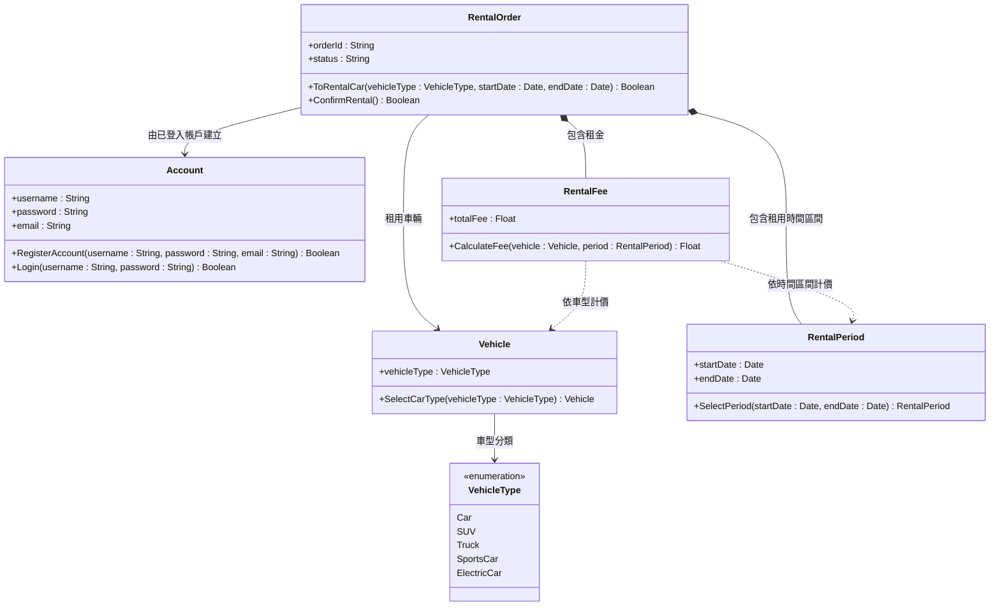

# CD_01 車輛租用系統 — Class Diagram

---

## 補充說明

| Class 名稱 | 中文名稱 | 職責說明 |
|------------|----------|----------|
| Account | 帳戶 | 負責註冊帳號與登入驗證。 |
| RentalOrder | 租車訂單 | 協調線上租車流程 ToRentalCar()，並負責確認租車 ConfirmRental()。 |
| Vehicle | 車輛(車型) | 負責選擇車型，車型為 Car、SUV、Truck、SportsCar、ElectricCar。 |
| RentalPeriod | 租用時間區間 | 記錄並選定租用起訖日期。 |
| RentalFee | 租金 | 依車型與租用時間區間計算租金。 |
| VehicleType | 車型列舉 | 列舉型別（非 Domain Object），定義可選車型。 |
