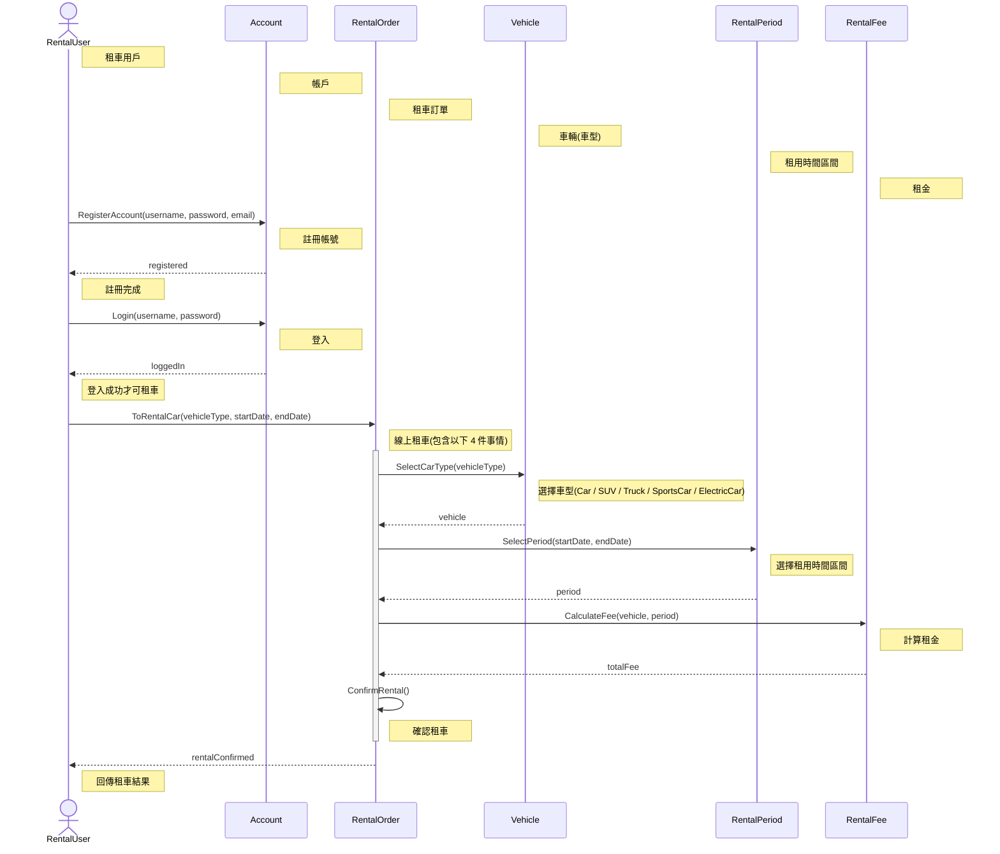

# SD_01 車輛租用系統 — Sequence Diagram

## 說明

- 領域物件由左至右依訊息呼叫順序排列：Account → RentalOrder → Vehicle → RentalPeriod → RentalFee。
- 租車前須先呼叫 `Account.RegisterAccount()` 與 `Account.Login()`。
- 「選擇車型、選擇租用時間區間、計算租金、確認租車」4 件事情皆包含在 `ToRentalCar()` 之中。
