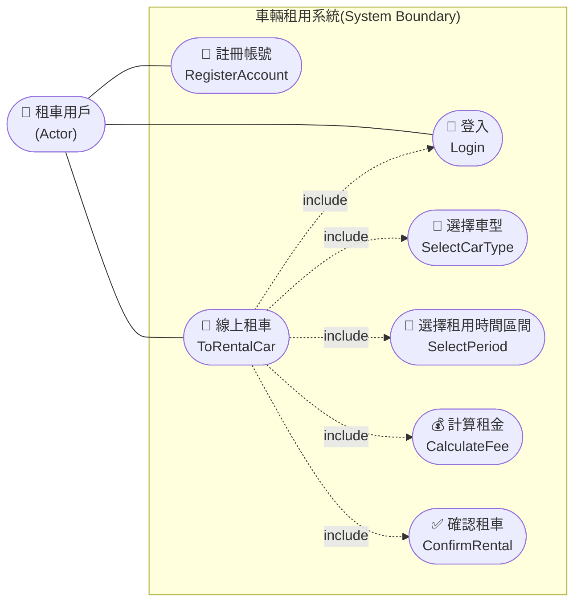

# UC_01 車輛租用系統 — Use Case Diagram

## Use Case 說明

| Use Case | 說明 |
|----------|------|
| 註冊帳號 (RegisterAccount) | 租車用戶在租車前，必須先註冊自己的帳戶資料。 |
| 登入 (Login) | 租車用戶使用已註冊的帳戶登入，登入後才可預先租用車輛。 |
| 線上租車 (ToRentalCar) | 租車用戶線上預約租車的主要 Use Case，包含登入、選擇車型、選擇租用時間區間、計算租金與確認租車。 |
| 選擇車型 (SelectCarType) | 從轎車 Car、休旅車 SUV、貨車 Truck、跑車 SportsCar、電動車 ElectricCar 中選擇車型。 |
| 選擇租用時間區間 (SelectPeriod) | 指定租用起訖日期。 |
| 計算租金 (CalculateFee) | 依車型與租用時間區間計算租金。 |
| 確認租車 (ConfirmRental) | 確認租車內容並完成預約。 |

**關係說明**：「線上租車」以 include 關係包含「登入」、「選擇車型」、「選擇租用時間區間」、「計算租金」、「確認租車」；「註冊帳號」為租車前須先完成的獨立 Use Case。
